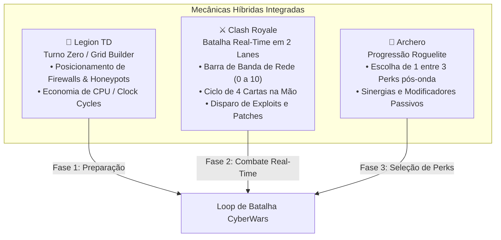
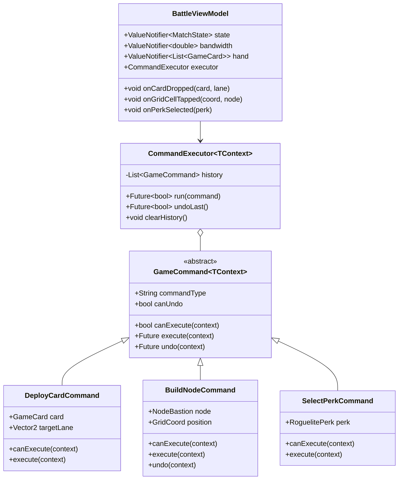
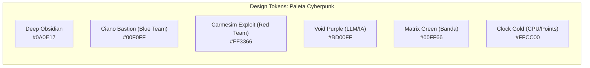

# 🕹️ Especificação Técnica do Frontend: PromptSec Arena (CyberWars)

> **Documento de Arquitetura e Startup de Engenharia Frontend**  
> **Framework:** Flutter 3.x (Web & Mobile)  
> **Engine Gráfica 2D:** Flame Engine (`flame-engine.org`)  
> **Padrão de Arquitetura:** MVVM Layered + Reusable Command Pattern  
> **Inspirações Mecânicas:** Clash Royale + Legion TD + Archero  
> **Status:** Aprovado e em Desenvolvimento (Startup Fase 1)  

---

## 🎯 1. Visão Geral e Identidade do Jogo

O frontend do **PromptSec Arena** é concebido como uma arena tática de cibersegurança em tempo real com formato *mobile-like* responsivo (ótima jogabilidade em telas verticais de smartphone e adaptada para navegadores desktop com moldura tática centralizada).

O jogo transforma conceitos abstratos de segurança cibernética (regras de firewall, injeção de prompts em LLMs, ataques de força bruta, túneis VPN e certificados pós-quânticos) em batalhas dinâmicas, intuitivas e viciantes.



---

## 💡 2. Proposta de Melhorias e Inovações no Gameplay

Para enriquecer a ideia original e transformá-la em um jogo memorável, introduzimos as seguintes mecânicas exclusivas:

### 2.1 O Paradoxo do SLA (Disponibilidade vs Segurança)
Em jogos de Tower Defense comuns, o jogador pode simplesmente trancar todo o caminho. Na cibersegurança do mundo real, isso derrubaria a empresa.
* **Mecânica:** O jogador Blue Team deve manter o tráfego legítimo (pacotes verdes de clientes HTTPS) fluindo até o Core do Servidor.
* **Tensão:** Se o Blue fechar a porta 443 ou aplicar regras drásticas demais, os clientes legítimos são bloqueados e o **Medidor de SLA** despenca. Perder 100% do SLA resulta em derrota por falência operacional.

### 2.2 O "LLM Crown" (O Cérebro da Cidadela)
Em vez de uma torre genérica, a base final de cada jogador abriga um **Nó de IA Central**:
* O Red Team pode disparar "Pacotes de Prompt Injection". Se o pacote alcançar o Core sem ser interceptado por firewalls ou filtros regex semânticos, ele atinge a IA.
* A barra de vida do Core é representada pela **Integridade do Prompt de Sistema** e monitorada pelo **Tension Meter (Logprobs)**.

### 2.3 Sistema de Sinergias Roguelite estilo Archero (Perks de Cibersegurança)
A cada onda concluída com sucesso ou a cada nó intermediário dominado, uma interface modal pausa a ação e apresenta 3 escolhas de modificadores:
* 🛡️ **PQC Guard (Pós-Quântico):** Aumenta em 40% a resistência contra tentativas de quebra de chaves parciais.
* ⚡ **Overclock de Clock:** Acelera a geração de Banda de Rede em +15%.
* 🪤 **Mirror Honeypot:** Nós Honeypot refletem 30% do dano de ataques de porta de volta para a barra de CPU do atacante.
* 💉 **Zero-Day Exploit:** O próximo exploit disparado ignora a primeira camada de WAF.

---

## 🏛️ 3. Arquitetura de Software: MVVM Layered + Command Pattern

O projeto utiliza **Clean MVVM** desacoplado, onde os eventos de entrada da interface são encapsulados em **Commands independentes e reutilizáveis**.



### 3.1 Benefícios do Command Pattern no Jogo
1. **Fase de Build com Undo Perfeito:** Na Fase de Preparação (Legion TD), o jogador pode reposicionar ou desfazer a construção de nós (`undo()`) com reembolso total de pontos antes da onda iniciar.
2. **Replay & Telemetria:** Cada comando armazena um snapshot que pode ser transmitido via WebSocket ao backend NestJS para validação anti-cheat e gravação de replays.
3. **Desacoplamento Visual:** A View do Flutter apenas dispara comandos sem conhecer as entranhas do motor físico do Flame.

---

## 🎨 4. Design System & Tokens Cyberpunk Neon

O design visual segue uma estética de **Alta Tecnologia Tática**, com iluminação neon sobre superfícies escuras que reduzem o cansaço visual e aumentam o contraste tático:



### 4.1 Tipografia e Efeitos
* **Monospace (Código & Métricas):** `JetBrains Mono` / `Share Tech Mono` para status de portas (`22/SSH`, `443/HTTPS`), IPs, logs de pacotes e valores de banda.
* **Gamer/Modern Sans (Títulos & Menus):** `Orbitron` ou `Inter` com tracking expandido para nomes de cartas e cabeçalhos.
* **Micro-animações:** Efeito de pulso luminoso nas bordas das cartas ativas e barra de carregamento de banda contínua com efeito gradiente.

---

## 🖼️ 5. Divisão Técnica: Flame Engine vs Flutter Overlays

Para máxima performance e facilidade de manutenção:

| Camada | Tecnologia | Responsabilidades |
| :--- | :--- | :--- |
| **Mundo do Jogo (Canvas)** | Flame Engine (`FlameGame`) | • Grid de rede interativo (linhas de dados e conexões)<br>• Animação de pacotes transitando nas rotas (Uplink/Downlink)<br>• Projéteis e lasers de defesa disparados pelos firewalls<br>• Efeitos de glitch e explosões de partículas |
| **HUD & Controles (Overlays)** | Flutter Widgets Nativos | • **CardDockWidget:** Barra de 4 cartas com custo de banda na base da tela (estilo Clash Royale)<br>• **BandwidthMeterWidget:** Barra de recarga fluida de 0 a 10 pontos de energia<br>• **MatchHeaderWidget:** Cronômetro da partida, SLA em tempo real e integridade do Core<br>• **PerkDraftDialog:** Modal estilo Archero para escolha de 1 entre 3 perks com animação de flip |

---

## 📁 6. Estrutura de Diretórios Proposta (`/frontend`)

```text
frontend/
├── pubspec.yaml
├── lib/
│   ├── main.dart
│   ├── core/
│   │   ├── commands/
│   │   │   ├── game_command.dart
│   │   │   └── command_executor.dart
│   │   ├── theme/
│   │   │   ├── app_colors.dart
│   │   │   ├── app_typography.dart
│   │   │   └── app_theme.dart
│   │   └── widgets/
│   │       ├── cyber_button.dart
│   │       ├── cyber_card.dart
│   │       └── cyber_badge.dart
│   ├── features/
│   │   └── battle/
│   │       ├── domain/
│   │       │   ├── models/
│   │       │   │   ├── game_card.dart
│   │       │   │   ├── bastion_node.dart
│   │       │   │   ├── roguelite_perk.dart
│   │       │   │   └── match_state.dart
│   │       │   └── repositories/
│   │       │       └── battle_repository.dart
│   │       ├── presentation/
│   │       │   ├── commands/
│   │       │   │   └── battle_commands.dart
│   │       │   ├── viewmodels/
│   │       │   │   └── battle_view_model.dart
│   │       │   ├── screens/
│   │       │   │   └── arena_screen.dart
│   │       │   └── widgets/
│   │       │       ├── card_dock_widget.dart
│   │       │       ├── bandwidth_meter_widget.dart
│   │       │       ├── match_header_widget.dart
│   │       │       └── perk_selection_dialog.dart
│   └── game/
│       ├── cyber_arena_game.dart
│       ├── components/
│       │   ├── network_grid_component.dart
│       │   ├── bastion_node_component.dart
│       │   ├── data_packet_component.dart
│       │   └── laser_beam_effect.dart
│       └── effects/
│           └── glitch_particle_factory.dart
```

---

## 🚀 7. Próximos Passos de Execução

1. Inicializar o projeto Flutter em `/frontend` com dependências `flame`, `google_fonts` e `flutter_animate`.
2. Implementar os arquivos de tokens de cores e temas (`app_colors.dart`, `app_theme.dart`).
3. Construir as interfaces de comandos reutilizáveis (`game_command.dart`, `command_executor.dart`).
4. Criar o protótipo funcional da Arena combinando o `FlameGame` para a grade tática e Overlays Flutter para o HUD de cartas e banda.
