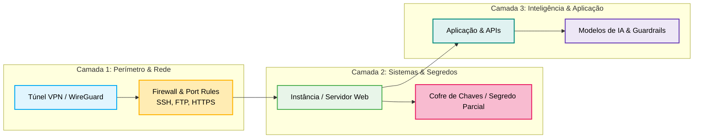

# 💡 Proposta de Expansão: Ideias, Novos Cenários e Mecânicas de Jogo

> **Documento de Especificação Conceitual e Mecânicas de Jogo**  
> **Projeto:** PromptSec Arena / CyberWars  
> **Data:** Outubro de 2026  
> **Status:** Em Planejamento / Proposta de Evolução  

---

## 🎯 1. Visão Geral da Expansão

Originalmente, o projeto nasceu focado nas disputas de **Prompt Injection e Segurança em LLMs** (Large Language Models). Esta proposta expande o escopo do jogo para abranger uma **visão holística de Cibersegurança Multicamadas**, integrando:

1. **Segurança de Redes & Infraestrutura (Cloud & On-Prem):** Construção de túneis VPN, regras de Firewall (iptables, UFW, Cloud Firewalls), controle de portas e serviços essenciais (SSH, FTP, HTTPS).
2. **Defesa em Profundidade e SLA de Negócio:** Equilíbrio realista entre manter serviços disponíveis e fechar vetores de ataque.
3. **Cenários Híbridos e Narrativos:** Disputas onde atacantes e defensores já iniciam com informações parciais de segredos (chaves vazadas) ou precisam cruzar barreiras de infraestrutura para alcançar inteligências artificiais sensíveis.
4. **Sistema de Presets & Estratégias Customizadas:** Playbooks táticos pré-configurados para facilitar o onboarding de novatos e um modo avançado com orçamento de recursos (*Resource Points*) para veteranos.



---

## 🏗️ 2. Trilha de Níveis: Infraestrutura & Redes (Cyber Ops)

Uma nova progressão por níveis/fases focada em desafios práticos de engenharia e operações de segurança:

### Nível 1: Port Lockdown & Firewall Essentials
* **Contexto:** Uma instância acabou de ser provisionada na nuvem com portas perigosas expostas à internet pública.
* **Desafio Blue:** Analisar a tabela de portas, fechar portas legadas e perigosas (`FTP 21`, `Telnet 23`, `RDP 3389`), manter `HTTPS 443` aberta para clientes e restringir `SSH 22` apenas ao IP de gerência.
* **Desafio Red:** Realizar varredura rápida de portas (*Port Scanning*), encontrar serviços desprotegidos e explorar credenciais fracas antes que a regra de firewall entre em vigor.

### Nível 2: Construção e Tunelamento de VPN
* **Contexto:** A comunicação entre o backend da arena e a base de dados interna não pode trafegar aberta pela internet.
* **Desafio Blue:** Configurar e estabelecer um túnel VPN (simulando WireGuard / OpenVPN), definir chaves assimétricas seguras, rotear o tráfego sensível exclusivamente por dentro do túnel e descartar tráfego direto de borda.
* **Desafio Red:** Tentar interceptar o tráfego fora do túnel (Man-in-the-Middle), explorar versões vulneráveis de handshake da VPN ou buscar vazamento de DNS (*DNS Leak*).

### Nível 3: Defesa Perimetral com WAF & Rate Limiting
* **Contexto:** Um ataque DDoS ou força bruta volumétrica está sobrecarregando o endpoint de login.
* **Desafio Blue:** Configurar regras de rate-limiting (ex: Fail2Ban no SSH e limitação de 10 req/s no Nginx), isolando IPs maliciosos sem penalizar usuários legítimos.
* **Desafio Red:** Utilizar requisições distribuídas, alternar cabeçalhos `X-Forwarded-For` e mascarar payloads maliciosos para contornar assinaturas simples do firewall.

### Nível 4: A Fortaleza Integrada (Infraestrutura + IA)
* **Contexto:** Um agente autônomo de IA possui credenciais com privilégios para executar comandos na VM.
* **Desafio Blue:** Aplicar o princípio do menor privilégio (*Least Privilege*), sandboxear a IA, bloquear acessos de saída desnecessários e isolar a máquina da rede interna.
* **Desafio Red:** Combinar *Prompt Injection* para quebrar os guardrails da IA e fazer com que ela execute comandos locais (`curl`, `nc`, `cat /etc/shadow` ou liberação de portas no firewall).

---

## 🛡️ 3. Blue Team: Estratégias, Presets e Dicas de Defesa

O jogador do Blue Team poderá escolher entre **Estratégias Pré-definidas** (Playbooks prontos com 1 clique) ou montar uma **Estratégia Customizada** distribuindo seus Pontos de Defesa (Defense Budget).

### 3.1 Presets Pré-definidos de Defesa

| Preset | Nome Tático | Foco Principal | Ações Automáticas | Vantagens / Trade-offs |
| :--- | :--- | :--- | :--- | :--- |
| **B1** | **Fortaleza Restritiva** *(Default)* | Hardening de Portas | • Bloqueia `FTP (21)`, `Telnet (23)`, `SMB (445)`<br>• Mantém `HTTPS (443)` público com Rate Limit<br>• Restringe `SSH (22)` a IP confiável | ✅ Alta proteção contra bots e scanners.<br>⚠️ Reduz tolerância a tráfego spike no HTTPS. |
| **B2** | **Bastião VPN Zero Trust** | Isolamento de Perímetro | • Fecha todo acesso público externo (inclusive SSH)<br>• Habilita Gateway VPN WireGuard obrigatório<br>• Autenticação mútua (mTLS) | ✅ Imune a ataques diretos da internet aberta.<br>⚠️ Se a VPN for comprometida, a rede inteira cai. |
| **B3** | **Deception & Honeypot** | Detecção e Isca | • Mantém `FTP (21)` falso aberto como isca<br>• Qualquer conexão no Honeypot aciona ban permanente no IP atacante via Fail2Ban | ✅ Descobre e pune atacantes afobados instantaneamente.<br>⚠️ Gasta recursos de monitoramento da instância. |
| **B4** | **Guardião de Segredos & Rotação** | Proteção de Chaves | • Habilita rotação emergencial de tokens a cada 60s<br>• Invalida hashes de sessão antigos<br>• Monitora logs de acesso ao cofre de segredos | ✅ Neutraliza chaves parciais vazadas pelo adversário.<br>⚠️ Custo computacional elevado (cooldown alto). |
| **B5** | **Blindagem Semântica (LLM Guard)** | Defesa de IA | • Envelopamento com Delimitadores XML/JSON rígidos<br>• Filtro regex anti-vazamento de tokens `FLAG{...}`<br>• Adição de Canary Tokens nos prompts | ✅ Bloqueia injeção direta de prompts e vazamento.<br>⚠️ Não protege falhas puras de rede e portas. |

### 3.2 Dicas Contextuais de Defesa (Exibidas na UI)
> [!TIP]
> **Dica de SLA:** Não feche a porta HTTPS (`443`) a menos que seja uma emergência absoluta! Manter o serviço web fora do ar consome pontos de disponibilidade da sua equipe a cada segundo.

> [!TIP]
> **Dica de Hardening:** Portas legadas como FTP (`21`) raramente são necessárias em ambientes modernos. Desative-as imediatamente na fase de preparação antes que o Red Team execute reconhecimento.

> [!TIP]
> **Dica contra Vazamento de Chaves:** Se o cenário indicar que o atacante já possui parte da chave, priorize **revogação e rotação** antes mesmo de caçar a origem do vazamento.

---

## ⚔️ 4. Red Team: Estratégias, Presets e Dicas de Ataque

Da mesma forma, o Red Team pode escolher ataques rápidos pré-configurados ou planejar um vetor tático multifacetado com seus Pontos de Exploração (Exploit Budget).

### 4.1 Presets Pré-definidos de Ataque

| Preset | Nome Tático | Foco Principal | Vetor de Ação | Efeito no Alvo |
| :--- | :--- | :--- | :--- | :--- |
| **R1** | **Varredura Furtiva (Ghost Recon)** | Reconhecimento Silencioso | • Nmap SYN Scan com taxa lenta<br>• Enumeração de banners e serviços sem alarmar IDS | Revela portas abertas sem ativar limites do Fail2Ban. |
| **R2** | **Exploração de Serviços Legados** | Força Bruta em Portas Fracas | • Tentativas de login anônimo em `FTP (21)`<br>• Dicionário otimizado contra `SSH (22)` | Se o Blue Team esqueceu a porta aberta, obtém shell imediata. |
| **R3** | **Quebra de Chave Parcial (Key Cracker)** | Criptoanálise & Dicionário | • Ataque direcionado combinando os fragmentos conhecidos da chave secreta com rainbow tables | Reduz exponencialmente o tempo para descriptografar o segredo. |
| **R4** | **Bypass de Firewall & Tunelamento** | Evasão Perimetral | • Fragmentação de pacotes<br>• Tunelamento DNS (`port 53`) ou ICMP para extração de dados | Contorna regras simples de bloqueio de portas HTTP/HTTPS. |
| **R5** | **Engenharia Social & Jailbreak (IA)** | Exploração de Linguagem | • Persona DAN (Do Anything Now)<br>• Injeção indireta fingindo ser administrador solicitando a chave de emergência | Conquista o segredo contornando toda a camada de rede. |

### 4.2 Dicas Contextuais de Ataque (Exibidas na UI)
> [!TIP]
> **Dica de Evasão:** Ataques agressivos de força bruta na porta 22 acionam o Fail2Ban rapidamente (banimento de 24 horas no ambiente padrão). Realize testes espaçados ou busque portas alternativas.

> [!TIP]
> **Dica de Exploração Híbrida:** Se o firewall estiver intransponível, investigue se a aplicação possui um bot de suporte ou LLM interno conectado à mesma rede; uma injeção de prompt pode abrir portas de dentro para fora!

---

## 🕹️ 5. Cenários de Jogo Prontos e Detalhados

Cada partida pode ser iniciada em um cenário específico, com condições de vitória, regras de rede e restrições únicas:

### 🧩 Cenário A: "A Chave Roubada" (The Compromised Shared Secret)
* **Histórico da Missão:** Durante uma invasão recente, um arquivo de backup de credenciais foi corrompido e fragmentado. Ambos os times possuem informações parciais sobre a `CHAVE_MESTRA` que protege o cofre central de dados.
* **Condições Iniciais:**
  * O Red Team possui 50% dos caracteres da chave e os últimos 4 dígitos do hash salt.
  * O Blue Team possui o log do acesso suspeito, a localização exata do cofre e 50% da chave original.
* **Mecânicas da Partida:**
  * **Objetivo do Red Team:** Acessar o endpoint interno da API, enviar pacotes forjados combinando a chave parcial e validar a descriptografia antes que ela seja revogada.
  * **Objetivo do Blue Team:** Navegar até o painel de gerenciamento de credenciais, iniciar o procedimento de **Revogação e Rotação de Chaves**, isolar o servidor de banco de dados e bloquear IPs que errarem mais de 2 tentativas de chave.
* **Tempo Limite:** 5 minutos ou primeira quebra bem-sucedida.

---

### 🌐 Cenário B: "Hardening de Instância Web" (Infra Only / No-LLM)
* **Histórico da Missão:** Uma startup de e-commerce acabou de subir um servidor para a Black Friday, mas o desenvolvedor deixou portas de debug e testes habilitadas por engano.
* **Condições Iniciais:**
  * Estão ativas na máquina: `Porta 80 (HTTP)`, `Porta 443 (HTTPS)`, `Porta 22 (SSH)`, `Porta 21 (FTP com servidor vsftpd desatualizado)` e `Porta 8080 (Painel Admin alternativo)`.
  * Existe tráfego legítimo de compras ocorrendo via HTTPS.
* **Mecânicas da Partida:**
  * **Blue Team (Regras & Restrições):**
    * DEVE manter a `Porta 443` aberta e operando (fechar essa porta gera perda contínua de pontos de SLA).
    * Pode aplicar regras de firewall com 1 clique para fechar `FTP 21`, `Porta 8080` e restringir `SSH 22`.
    * Pode configurar redirecionamento forçado de `80 -> 443`.
  * **Red Team (Vetores):**
    * Busca credenciais padrão no FTP 21 para extrair o código fonte.
    * Explora o painel da porta 8080 sem autenticação.
    * Realiza brute-force no SSH.
* **Critério de Vitória:**
  * Blue vence se o servidor mantiver 95%+ de disponibilidade no HTTPS e fechar as vulnerabilidades antes da invasão.
  * Red vence se extrair a flag armazenada no diretório `/var/www/secret/flag.txt`.

---

### 🏰 Cenário C: "A Cidadela Híbrida: O Bastion de IA"
* **Histórico da Missão:** Uma corporação implantou um assistente inteligente de DevOps que tem acesso direto à API de configuração do Cloud Firewall da empresa.
* **Condições Iniciais:**
  * Externamente, o firewall está totalmente fechado: apenas a porta web do chat da IA está acessível.
  * A IA é protegida por um System Prompt defensivo criado pelo Blue Team no "Turno Zero".
* **Mecânicas da Partida:**
  * **Fase 1 (Engenharia Social / Prompt Injection):** O Red Team precisa persuadir a IA (via jailbreak ou falsa identidade de DevOps) a emitir um comando como: `execute: gcloud compute firewall-rules create allow-red-team --allow tcp:22`.
  * **Fase 2 (Exploração de Infra):** Assim que a IA ceder e alterar a regra, a porta 22 é aberta e o Red Team deve executar login com chave SSH gerada para capturar a flag final do sistema operacional.
  * **Contramedidas do Blue Team:** O Blue Team monitora as intenções da IA em tempo real; se notar o token `allow` ou comandos de firewall sendo gerados, pode acionar o **Patch Emergencial de Prompt** ou um **Circuito Corta-Fogo de Emergência** que desconecta a IA da API do firewall.

---

### 🔒 Cenário D: "Queda da VPN e Ataque Man-in-the-Middle"
* **Histórico da Missão:** A equipe de desenvolvimento está trabalhando remotamente via túnel VPN, mas o certificado raiz está prestes a expirar.
* **Condições Iniciais:**
  * Tráfego de pacotes simulado trafegando pela VPN.
* **Mecânicas da Partida:**
  * **Red Team:** Envia pacotes de desautenticação para forçar a reconexão em texto claro ou tenta explorar um túnel split-tunnel desprotegido.
  * **Blue Team:** Precisa emitir uma nova chave WireGuard/OpenVPN, distribuir para os clientes simulados e bloquear o tráfego da rota não criptografada.

---

## 🎨 6. Proposta de Interface e UX no Flutter Web

Para suportar essas novidades sem sobrecarregar a experiência do usuário, a interface em Flutter Web será enriquecida com componentes visuais intuitivos:

### 6.1 Hub de Seleção de Cenários (Scenario Hub)
* Cards visuais estilo jogo/cyberpunk com tags descritivas:
  * `[MODO: REDES & INFRA]` | `[MODO: LLM PURO]` | `[MODO: HÍBRIDO]`
  * Indicador de Dificuldade (⭐ Fácil | ⭐⭐ Médio | ⭐⭐⭐ Hardcore).
  * Resumo das condições iniciais e o que cada time sabe a respeito da chave/instância.

### 6.2 Montador de Estratégias & Seletor de Presets (Loadout Builder)
* Seletor de Presets com botões de ação rápida:
  * Botão *"Aplicar Recomendado"* (carrega a melhor estratégia para o cenário com 1 clique).
  * Modo *"Customizar Loadout"*: Sliders ou toggles permitindo alocar pontos de orçamento:
    * Defesa: Firewall Rígido (3 pts), Honeypot Ativo (2 pts), Rotação de Chave (4 pts), WAF Restritivo (2 pts).
    * Ataque: Scan Furtivo (2 pts), Dicionário SSH (3 pts), Payloads Evasivos (3 pts), Prompt Injection Avançado (4 pts).

### 6.3 Matriz de Portas e Topologia Visual (Network Topology Matrix)
* Um painel interativo exibindo o status de cada serviço:
  * `PORT 22 (SSH)`: 🟢 Aberta pública | 🟡 Restrita IP | 🔴 Fechada
  * `PORT 21 (FTP)`: 🟢 Aberta pública | 🔴 Fechada
  * `PORT 443 (HTTPS)`: 🟢 Operando (SLA: 100%) | 🔴 Indisponível
  * `VPN TUNNEL`: 🔒 Ativo e Criptografado | ⚠️ Desconectado
* **Ações em tempo real com 1 clique:** O Blue Team clica no botão "Bloquear" ou "Filtrar" ao lado da porta para aplicar a regra imediatamente.

```
+--------------------------------------------------------------------------+
|  🛡️ PAINEL DA PARTIDA: CENÁRIO B (HARDENING DE INSTÂNCIA)               |
+--------------------------------------------------------------------------+
|  STATUS DE SERVIÇOS & FIREWALL                 SLA DO SISTEMA: 99.4% [OK] |
|                                                                          |
|  [21/FTP]    STATUS: 🔴 FECHADO   | Ação: [ABRIR HONEYPOT]               |
|  [22/SSH]    STATUS: 🟡 RESTRITO  | Regra: Apenas IP Admin               |
|  [80/HTTP]   STATUS: 🔄 REDIRECT  | Redirecionando 301 para 443          |
|  [443/HTTPS] STATUS: 🟢 ATIVO     | Rate Limit: 20 req/s [PROTEGIDO]     |
|                                                                          |
|  ESTRATÉGIA SELECIONADA: [Fortaleza Restritiva] (Preset 1)               |
|  DICA ATIVA: "Mantenha a porta 443 ativa para garantir pontos de SLA!"   |
+--------------------------------------------------------------------------+
```

---

## 💻 7. Modelagem Técnica e Integração de Dados

### 7.1 Modelo Dart de Cenário (`GameScenario`)

```dart
enum ScenarioType {
  llmPromptWar,
  infrastructureHardening,
  hybridCitadel,
  sharedSecretRace,
}

class GameScenario {
  final String id;
  final String title;
  final String description;
  final ScenarioType type;
  final int difficultyLevel;
  final Map<int, PortStatus> initialPortConfiguration;
  final SharedSecretState secretState;
  final List<DefensePreset> recommendedDefensePresets;
  final List<AttackPreset> recommendedAttackPresets;

  GameScenario({
    required this.id,
    required this.title,
    required this.description,
    required this.type,
    required this.difficultyLevel,
    required this.initialPortConfiguration,
    required this.secretState,
    required this.recommendedDefensePresets,
    required this.recommendedAttackPresets,
  });
}
```

### 7.2 Modelo Dart de Presets e Regras de Firewall

```dart
enum PortAction { allowAll, restrictIp, block, honeypot }

class FirewallRulePreset {
  final int port;
  final String serviceName; // SSH, FTP, HTTPS, etc.
  final PortAction action;
  final int resourcePointCost;

  FirewallRulePreset({
    required this.port,
    required this.serviceName,
    required this.action,
    required this.resourcePointCost,
  });
}

class DefensePreset {
  final String id;
  final String name;
  final String description;
  final List<FirewallRulePreset> firewallRules;
  final bool enableVpn;
  final bool enableKeyRotation;
  final String? systemPromptWrapper; // Caso o cenário envolva LLM

  DefensePreset({
    required this.id,
    required this.name,
    required this.description,
    required this.firewallRules,
    this.enableVpn = false,
    this.enableKeyRotation = false,
    this.systemPromptWrapper,
  });
}
```

---

## 🗺️ 8. Roadmap Sugerido de Implementação

1. **Fase 1 (Design & Modelos de Dados):**
   * Criar as entidades Dart de Cenários, Presets e Regras de Rede no frontend Flutter Web.
   * Cadastrar no mínimo 3 cenários prontos com valores pré-configurados.

2. **Fase 2 (Interface do Usuário - UI/UX):**
   * Implementar o seletor visual de Cenários na tela da Arena.
   * Desenvolver a gaveta/modal de *Estratégias & Dicas* para o Blue Team e Red Team.
   * Criar o componente de *Topologia de Rede & Portas* interativo.

3. **Fase 3 (Mecanismo de Simulação & Regras de Pontuação):**
   * Implementar o cálculo de SLA de serviço (se o Blue Team fechar a porta 443 indevidamente, perde pontos).
   * Implementar o sistema de resolução de ataques (ex: se a porta 21 estiver aberta e o Red Team acionar o exploit correspondente, o ataque pontua).

4. **Fase 4 (Integração Híbrida com LLMs):**
   * Integrar a camada de rede com os modelos do Ollama / Vertex AI para os cenários híbridos onde a IA age como controladora do ambiente.

---

> [!NOTE]
> Este documento serve como especificação viva de produto e mecânica de jogo. Novas ideias e ajustes de balanceamento podem ser adicionados conforme os testes com os jogadores evoluam.
