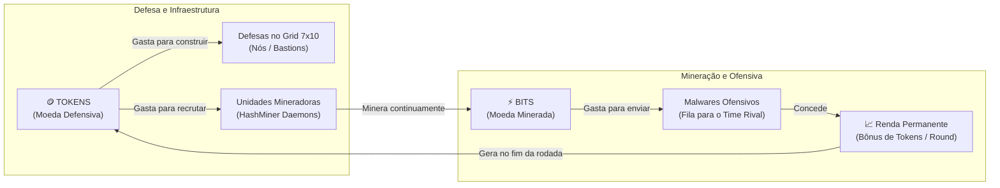

# 📜 Regras Oficiais do Jogo - PromptSec Arena (CyberWars)

Este documento estabelece as regras canônicas de jogabilidade, economia, estrutura do tabuleiro top-down, mecânicas de combate elemental e fluxo de partida do **PromptSec Arena** (modo híbrido Legion TD / RTS competitivo 4v4).

---

## 🏛️ 1. Visão Geral da Partida

PromptSec Arena é uma batalha tática entre duas equipes de 4 jogadores:
* 🔵 **Time Aliado (Blue Team / Defensores do Core)**
* 🔴 **Time Adversário (Red Team / Oponentes)**

Cada equipe defende o seu respectivo **MAINFRAME CENTRAL**, enquanto minera recursos para enviar malwares e ataques para sobrecarregar a infraestrutura da equipe oponente. A partida termina quando o Mainframe de uma das equipes for completamente destruído (HP = 0).

---

## 🗺️ 2. Estrutura do Mapa e Tabuleiro Top-Down

### 2.1. Visão Geral do Tabuleiro
O campo de cada time é organizado em uma visão superior (**Top-Down**) como um tabuleiro de jogo tático:

```
+-------------------------------------------------------------+
|                      [ZONA DE SPAWN]                        |
|   +-----------------------+     +-----------------------+   |
|   |      JOGADOR 1        |     |      JOGADOR 3        |   |
|   |   (Top-Left - 7x10)   |     |   (Top-Right - 7x10)  |   |
|   +-----------------------+     +-----------------------+   |
|             | <--- 300px distância ---> |                   |
|                   ====================                      |
|                   | MAINFRAME CENTRAL|                      |
|                   |   [ÁREA VISÍVEL] |                      |
|                   ====================                      |
|             | <--- 300px distância ---> |                   |
|   +-----------------------+     +-----------------------+   |
|   |      JOGADOR 2        |     |      JOGADOR 4        |   |
|   | (Bottom-Left - 7x10)  |     | (Bottom-Right - 7x10) |   |
|   +-----------------------+     +-----------------------+   |
|                      [ZONA DE SPAWN]                        |
+-------------------------------------------------------------+
```

### 2.2. Cores Predefinidas dos Jogadores
Cada jogador possui uma cor de identificação atribuída permanentemente para destacar suas bordas de grid, nós no tabuleiro e painéis de telemetria:

| Time | Posição no Tabuleiro | Identificador | Cor Hex | Nome da Cor |
| :--- | :--- | :--- | :--- | :--- |
| **Aliado (Azul)** | Top-Left | Jogador 1 | `#00F0FF` | Ciano Neon |
| **Aliado (Azul)** | Bottom-Left | Jogador 2 | `#9D00FF` | Púrpura Neon |
| **Aliado (Azul)** | Top-Right | Jogador 3 | `#00FF66` | Esmeralda Neon |
| **Aliado (Azul)** | Bottom-Right | Jogador 4 | `#FFCC00` | Âmbar Dourado |
| **Adversário (Vermelho)** | Top-Left | Rival 1 | `#FF3366` | Carmim Neon |
| **Adversário (Vermelho)** | Bottom-Left | Rival 2 | `#FF6600` | Laranja Neon |
| **Adversário (Vermelho)** | Top-Right | Rival 3 | `#FF0099` | Magenta Neon |
| **Adversário (Vermelho)** | Bottom-Right | Rival 4 | `#E6FF00` | Amarelo Ácido |

### 2.3. Câmera e Navegação Tática
1. **Visão Geral Tática Padrão (Zoom Out)**: A câmera exibe os 4 setores dos aliados simultaneamente ao redor do Mainframe Central, permitindo acompanhar o estado global da partida como em um RTS clássico (Warcraft 3).
2. **Foco Dinâmico**: Ao clicar ou tocar no setor de um jogador, a câmera realiza um zoom suave para focar na grade 7x10 correspondente para alocação e manutenção de nós.
3. **Retorno Rápido**: Um botão de centralização (*Overview Tático*) restaura a visão global instantaneamente.

### 2.4. Regra de Ocultação do Mapa (Fog of War)
* **Bases Ocultas**: As grades de unidades 7x10 e as construções individuais do time adversário permanecem estritamente **ocultas** para você e seus aliados (Fog of War / inteligência de defesa confidencial).
* **Zona do Mainframe Aberta**: A área central imediata do **Mainframe adversário** é visível. As unidades inimigas que estão posicionadas ao redor do Mainframe para protegê-lo podem ser visualizadas por ambos os times.

---

## ⚡ 3. Mecânica de Spawn, Waves e Defesa de Leaks

### 3.1. Spawn de Ameaças
* O spawn dos malwares de cada onda acontece **logo acima da grade 7x10** de cada jogador.
* As ameaças descem em linha pelas células da grade enfrentando os nós defensivos alocados naquele quadrante.

### 3.2. Conclusão da Wave e Movimentação Protetora
* Quando um jogador elimina com sucesso todas as ameaças do seu quadrante, suas unidades defensivas sobreviventes recebem uma ordem de contingência:
  - **Deslocam-se imediatamente para o centro do tabuleiro, formando um perímetro defensivo ao redor do MAINFRAME CENTRAL.**

### 3.3. Mecânica de Leak (Vazamento de Tráfego)
* Caso um jogador não consiga deter todas as ameaças em seu quadrante de 7x10, as unidades não neutralizadas sofrem **LEAK** (vazam).
* As ameaças que vazaram avançam diretamente em direção ao **MAINFRAME CENTRAL**.
* As unidades dos aliados que já limparam suas waves e estão posicionadas ao redor do Mainframe **interceptam e combatem as ameaças que vazaram**, evitando que o Mainframe sofra dano!
* **Dano Direto ao Mainframe**: Apenas as ameaças que conseguirem ultrapassar o perímetro do Mainframe causam dano direto aos pontos de vida do Core.
* Se os pontos de vida do Mainframe chegarem a zero, o time sofre **Derrota Imediata**.

---

## 💰 4. Nova Economia (Tokens & Bits)

A economia foi reformulada para o modelo simétrico do Legion TD:



### 4.1. Tokens (Substitui totalmente o termo "CPU")
* **Finalidade**: Moeda de defesa e infraestrutura.
* **Uso**:
  - Construir nós defensivos no tabuleiro 7x10.
  - Fazer upgrade de nós existentes.
  - Comprar novas unidades mineradoras (*HashMiner Daemons*).
* **Como Obter**:
  - Quantia inicial de preparação (Turno Zero): 120 Tokens.
  - Renda básica fixa no final de cada round (+60 Tokens).
  - Bônus permanente de renda concedido pelo envio de malwares com Bits.
  - Recompensa por eliminação de pacotes maliciosos.

### 4.2. Bits (Moeda Minerada Acumulativa)
* **Finalidade**: Moeda ofensiva e mercenária.
* **Uso**:
  - Enviar malwares adicionais contra a equipe rival na próxima rodada.
* **Como Obter**:
  - Gerada continuamente ao longo da partida pelas unidades mineradoras.
  - Taxa base: 0.5 Bits/segundo + 0.4 Bits/segundo por minerador ativo.

---

## 🖥️ 5. Módulos Táticos da Interface (HUD RTS)

### 5.1. Módulo de Recursos da Equipe (Exclusivo dos Aliados)
Inspirado na telemetria tática do Warcraft 3, este módulo é visível **apenas para os membros do próprio time**:
* Exibe os 4 jogadores aliados com seus respectivos avatares e cores predefinidas.
* Informações em tempo real por jogador:
  - Saldo atual de **Tokens**.
  - Saldo acumulado de **Bits**.
  - Quantidade de **HashMiners** em operação.
  - Status na onda atual:
    - 🟢 *Em Combate* (defendendo a própria grade 7x10)
    - 🔵 *Wave Limpa* (unidades protegendo o Mainframe central)
    - 🔴 *Vazamento Ativo* (sofrendo leak, solicitando suporte no Mainframe)

### 5.2. Módulo de Mineração (HashMiner Hub)
Painel desacoplado da grade de combate (mineradores não ocupam espaço na grade 7x10):
* Exibe a taxa global de mineração (Hashrate / Bits por segundo).
* Botão para aquisição de **HashMiner Daemons**:
  - Custo escalonado em Tokens: `50 + (minersCount - 1) * 15 Tokens`.
  - Limite máximo: 12 mineradores por jogador.

### 5.3. Módulo de Ataques Submetidos (Fila para a Próxima Rodada)
Gaveta tática com os ataques contratados pela equipe:
* Mostra quais malwares foram comprados com Bits pelos membros da equipe durante a rodada.
* Esses malwares são despachados **em conjunto com a wave seguinte do time adversário**, gerando sobrecarga simultânea coordenada.

---

## 🔥 6. Sistema de Combate e Matriz Elemental

### 6.1. Força Ofensiva em Bits (Substituição de Espada Medieval)
* O poder de ataque de qualquer unidade é expressado em **Bits de Carga Ofensiva** (ícone de Bits / Chipset), indicando o volume de dados e payload destrutivo por disparo.
* Quanto maior o volume de Bits ofensivos, maior o dano nominal base.

### 6.2. Categorias Elementais de Dano e Defesa
Para o balanceamento de tipos de ataque e tipos de blindagem, o jogo utiliza as 4 Forças Elementais da Natureza:

1. 🔥 **Fogo (Fire)**: Dano concentrado térmico e combustão de portas lógicas.
2. 💧 **Água (Water)**: Resfriamento dinâmico, fluxo de pacotes e amortecimento.
3. 🌍 **Terra (Earth)**: Blindagem densa de silício, aterramento e barreiras estáticas.
4. 💨 **Ar (Air)**: Ondas de rádio de alta frequência, dispersão e rajadas rápidas.
5. ⚡ **Mainframe**: Núcleo blindado central (Neutro / Balanceado).

### 6.3. Tabela Canônica de Multiplicadores de Dano

| Tipo de Dano (Bits) \ Blindagem | 🔥 Fogo | 💧 Água | 🌍 Terra | 💨 Ar | ⚡ Mainframe |
| :--- | :---: | :---: | :---: | :---: | :---: |
| 🔥 **Fogo** | 100% | **75%** | 100% | **125%** | 100% |
| 💧 **Água** | **125%** | 100% | **75%** | 100% | 100% |
| 🌍 **Terra** | 100% | **125%** | 100% | **75%** | 100% |
| 💨 **Ar** | **75%** | 100% | **125%** | 100% | 100% |

#### Regra da Roda de Vantagens:
* 🔥 **Fogo** consome 💨 **Ar** (125%), mas é atenuado por 💧 **Água** (75%).
* 💧 **Água** apaga 🔥 **Fogo** (125%), mas é absorvida por 🌍 **Terra** (75%).
* 🌍 **Terra** soterra/absorve 💧 **Água** (125%), mas é erodida por 💨 **Ar** (75%).
* 💨 **Ar** dispersa 🌍 **Terra** (125%), mas alimenta/é vulnerável a 🔥 **Fogo** (75%).

---

## ⚙️ 7. Motor de Regras (`GameRuleEngine`)

O motor de regras no código da aplicação (`lib/core/rules/game_rule_engine.dart`) executa as seguintes responsabilidades:
1. **`calculateDamage(baseBits, attackElement, defenseElement)`**: Aplica o multiplicador da matriz canônica.
2. **`calculateMinerBits(minersCount, deltaTime)`**: Processa o acúmulo contínuo de Bits na economia.
3. **`validateBuild(tokens, nodeCost)`**: Garante que o jogador tem Tokens suficientes para construir ou evoluir nós.
4. **`validateSendAttack(bits, virusCost)`**: Garante que o jogador tem Bits suficientes para despachar malwares.
5. **`processWaveLeak(clearedPlayers, leakingThreats, mainframe)`**: Direciona defensores e ameaças que vazaram para o combate no Mainframe Central.
6. **`checkVictoryCondition(blueMainframeHp, redMainframeHp)`**: Avalia se algum Mainframe foi destruído.
