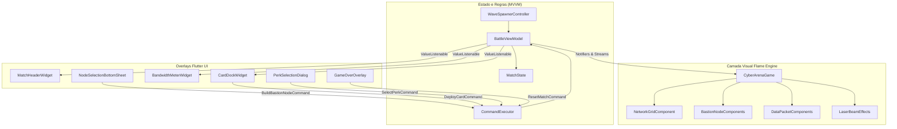

# 🗺️ Roadmap Técnico: MVP de Partida Single-Player (Offline)

> **Documento de Planejamento e Decomposição de Tarefas (Backlog)**  
> **Projeto:** PromptSec Arena (CyberWars Frontend)  
> **Objetivo:** Viabilizar uma partida completa jogável localmente (Sem necessidade de WebSockets/Backend), cobrindo do Turno Zero (Legion TD) ao Combate em Tempo Real (Clash Royale), Seleção de Perks (Archero) e Telas de Vitória/Derrota.  
> **Data:** Outubro de 2026  
> **Status:** Em Execução / Prioridade Máxima  

---

## 🎯 1. Definição do Escopo do MVP

O MVP foca em **uma experiência de jogo 100% autônoma no frontend**, simulando o oponente adversário através de um **Scripted Wave Spawner (Gerador de Ondas Autônomo)**. 

### O que ESTÁ no escopo do MVP:
* Partida completa de 3 ondas progressivas.
* Alocação e remoção de nós defensivos na grade tática durante a Fase de Preparação.
* Batalha em tempo real com disparo de cartas, consumo de Banda de Rede e colisão de pacotes.
* Bastiões atacando pacotes inimigos que entram no seu raio de alcance.
* Penalidade de SLA se pacotes legítimos forem bloqueados ou se portas essenciais falharem.
* Pausa tática ao final de cada onda para escolha de 1 entre 3 Perks estilo Archero.
* Detecção de Vitória (todas as ondas superadas) e Derrota (LLM Core a 0% ou SLA a 0%).
* Overlay de Fim de Jogo com métricas e botão de "Jogar Novamente".

### O que NÃO está no escopo do MVP (Fases Futuras):
* Conexão WebSocket em tempo real com o backend NestJS.
* Multiplayer PvP Red vs Blue em rede.
* Chat e telemetria de logprobs conectada a modelos remotos de LLM (Ollama/Vertex).
* Persistência em banco de dados e ranking online.

---

## 🏗️ 2. Arquitetura do MVP Local



---

## 📋 3. Backlog de Épicos e Tarefas Detalhadas

### 🏰 ÉPICO 1: Interatividade do Grid & Construção de Nós (Legion TD)
> **Objetivo:** Permitir que o jogador toque em células da grade e construa diferentes tipos de nós usando seu orçamento de CPU, com opção de desfazer alocações.

- [x] **Task 1.1: Menu de Seleção de Nós ao Tocar no Grid**
  * **Descrição:** Ao tocar em uma célula vazia da grade durante a Fase de Preparação, abrir uma folha inferior (`NodeSelectionBottomSheet`) exibindo os bastiões disponíveis para compra (Firewall, Honeypot, WAF Proxy, IDS Sentinel) com custo em CPU e atributos.
  * **Critérios de Aceite:**
    * Células já ocupadas não abrem menu de nova compra, mas exibem card de status com HP do nó e opção de desmontagem.
    * Nós cujo custo em CPU é superior ao saldo do jogador aparecem desabilitados.
  * **Arquivos:** `lib/game/components/network_grid_component.dart`, `lib/features/battle/presentation/widgets/node_selection_sheet.dart`.

- [x] **Task 1.2: Renderização Visual dos Bastiões com Alcance e Animação**
  * **Descrição:** Criar o componente Flame `BastionNodeComponent` com ícone personalizado para cada tipo de nó, anel de pulso luminoso (neon glow) e indicador circular semitransparente exibindo o raio de alcance (`attackRange`).
  * **Critérios de Aceite:**
    * O nó renderiza corretamente sua barra de integridade sobreposta.
    * Ao selecionar um nó, seu raio de alcance é destacado na tela.
  * **Arquivos:** `lib/game/components/bastion_node_component.dart`.

- [x] **Task 1.3: Aprimoramento do Comando de Undo e Reembolso de CPU**
  * **Descrição:** Garantir que o botão de desfazer no `MatchHeaderWidget` remova o último nó construído do `FlameGame`, restaure o saldo de CPU e atualize o contador do histórico de comandos.
  * **Critérios de Aceite:**
    * O nó desaparece imediatamente do canvas sem deixar resíduos visuais.
    * O saldo de CPU é restituído integralmente.
  * **Arquivos:** `lib/features/battle/presentation/commands/battle_commands.dart`, `lib/features/battle/presentation/viewmodels/battle_view_model.dart`.

- [x] **Task 1.4: Gatilho de Transição do Turno Zero para a Batalha**
  * **Descrição:** Quando o cronômetro do Turno Zero zerar ou o jogador clicar em "PRONTO", limpar o histórico de undo, travar novas construções na grade e disparar a animação de início de combate na arena.
  * **Critérios de Aceite:**
    * Transição de estado de `MatchPhase.preparation` para `MatchPhase.battle`.
    * Limpeza de `_history` no `CommandExecutor` para evitar desmanchar nós durante o combate.
  * **Arquivos:** `lib/features/battle/presentation/viewmodels/battle_view_model.dart`, `lib/features/battle/presentation/screens/arena_screen.dart`.

---

### ⚔️ ÉPICO 2: Motor de Combate, Interceptação e Projéteis (Clash Royale)
> **Objetivo:** Fazer os pacotes transitarem pelas duas rotas, permitir que os bastiões detectem e atirem contra pacotes inimigos, e calcular dano ao Core e ao SLA.

- [x] **Task 2.1: Controlador de Ondas Scriptadas (Wave Spawner)**
  * **Descrição:** Criar uma classe controladora no ViewModel que gerencia a geração de pacotes inimigos por onda com dificuldade progressiva:
    * **Onda 1 (Port Scanners):** Pacotes rápidos de baixa vida descendo na Lane 1 e Lane 2.
    * **Onda 2 (SYN Flood):** Enxame de múltiplos pacotes leves simultâneos.
    * **Onda 3 (Boss Payload / Zero-Day):** Pacote blindado de alta integridade que requer foco de fogo dos bastiões.
  * **Critérios de Aceite:**
    * A onda possui contagem de pacotes restante e duração delimitada.
    * Ao eliminar todos os pacotes da onda, dispara o evento de vitória da onda.
  * **Arquivos:** `lib/features/battle/domain/services/wave_spawner_service.dart`.

- [x] **Task 2.2: Sistema de Detecção e Tiro dos Bastiões (Combat Loop)**
  * **Descrição:** No método `update(dt)` do `BastionNodeComponent` ou do jogo, verificar a distância Euclidiana entre o nó e os pacotes inimigos ativos. Se um pacote estiver dentro do `attackRange`, disparar um efeito de laser (`LaserBeamEffect`) em sua direção e aplicar dano contínuo ou por rajada.
  * **Critérios de Aceite:**
    * O laser conecta visualmente o nó ao pacote alvo por 150ms com cor correspondente (Ciano para Firewall, Roxo para WAF).
    * O pacote atingido tem sua vida reduzida e pisca em branco (hit flash).
    * Se o HP do pacote zerar, ele se dissolve em partículas de dados e é removido da cena.
  * **Arquivos:** `lib/game/components/laser_beam_effect.dart`, `lib/game/cyber_arena_game.dart`.

- [x] **Task 2.3: Impacto na Base e Dano ao LLM Core**
  * **Descrição:** Se um pacote inimigo alcançar o final da rota sem ser interceptado, ele colide com o Core da base.
  * **Critérios de Aceite:**
    * Dispara um efeito visual de tremor de tela ou pulso vermelho no Core.
    * Subtrai o dano do pacote da `coreAiIntegrity` no `MatchState`.
    * O medidor de integridade no cabeçalho atualiza fluidamente.
  * **Arquivos:** `lib/game/components/data_packet_component.dart`, `lib/features/battle/presentation/viewmodels/battle_view_model.dart`.

- [x] **Task 2.4: Tráfego de Clientes Legítimos e Medidor de SLA**
  * **Descrição:** Periodicamente, pacotes verdes (clientes legítimos HTTPS) tentam trafegar até o servidor. Se passarem com sucesso, o SLA se mantém em 100%. Se colidirem com regras excessivamente restritivas ou se os nós estiverem danificados, o pacote é descartado e o SLA cai.
  * **Critérios de Aceite:**
    * Se o SLA cair para 0%, resulta em derrota imediata.
    * O jogador pode usar a carta "Hot-Patch" para reparar nós e recuperar o SLA.
  * **Arquivos:** `lib/features/battle/domain/models/match_state.dart`.

---

### 🃏 ÉPICO 3: Controles da Mão de Cartas & Drag-to-Lane
> **Objetivo:** Refinar a jogabilidade estilo Clash Royale, tornando intuitivo disparar cartas diretamente nas lanes.

- [x] **Task 3.1: Toque Direto ou Arrastar para Lane**
  * **Descrição:** Permitir que o jogador toque em uma carta no dock e toque diretamente na Lane 1 ou Lane 2 no tabuleiro para despachá-la, ou mantenha a folha rápida de seleção com visual gamer cyberpunk.
  * **Critérios de Aceite:**
    * A carta só é despachada se `bandwidth >= card.bandwidthCost`.
    * A energia de banda é deduzida instantaneamente na barra superior.
  * **Arquivos:** `lib/features/battle/presentation/widgets/card_dock_widget.dart`, `lib/game/cyber_arena_game.dart`.

- [x] **Task 3.2: Animação de Ciclo de Cartas**
  * **Descrição:** Quando uma carta é jogada, ela sai da mão com animação de fade/slide para a esquerda e uma nova carta do deck entra pela direita.
  * **Critérios de Aceite:**
    * A mão sempre mantém exatamente 4 cartas ativas.
    * O deck cicla continuamente sem repetições imediatas.
  * **Arquivos:** `lib/features/battle/presentation/widgets/card_dock_widget.dart`.

---

### 🏹 ÉPICO 4: Progressão Roguelite Pós-Onda (Archero)
> **Objetivo:** Recompensar a sobrevivência a cada onda com modificadores cumulativos que alteram o comportamento da partida.

- [x] **Task 4.1: Gatilho de Vitória de Onda e Pausa Tática**
  * **Descrição:** Ao derrotar todos os inimigos da Onda 1 ou 2, pausar a simulação do Flame e abrir automaticamente o modal `PerkSelectionDialog`.
  * **Critérios de Aceite:**
    * O jogo pausa completamente (pacotes param de se mover).
    * O modal exibe 3 opções sorteadas de um catálogo de 8+ perks.
  * **Arquivos:** `lib/features/battle/presentation/screens/arena_screen.dart`.

- [x] **Task 4.2: Efeito Prático dos Perks nos Atributos**
  * **Descrição:** Conectar o efeito do perk escolhido aos cálculos da partida:
    * *Overclock de CPU:* Aumenta a taxa de regeneração de banda de 0.35 para 0.50 por tick.
    * *PQC Guard:* Reduz em 50% todo dano que atingir o Core.
    * *Torre Canhão Laser:* Aumenta o dano de ataque dos nós em +35%.
  * **Critérios de Aceite:**
    * O modificador é refletido na lista `activePerks` e altera imediatamente o comportamento do jogo.
    * Após selecionar o perk, o jogo retoma com a próxima onda.
  * **Arquivos:** `lib/features/battle/presentation/commands/battle_commands.dart`, `lib/features/battle/presentation/viewmodels/battle_view_model.dart`.

---

### 🏆 ÉPICO 5: Condições de Vitória, Derrota e Loop de Reinício
> **Objetivo:** Fechar o ciclo completo da partida com telas de desfecho e possibilidade de jogar novamente.

- [x] **Task 5.1: Verificação Contínua de Condições de Fim de Partida**
  * **Descrição:** Criar listeners no ViewModel que detectam:
    * **Vitória:** Onda 3 concluída com Core > 0% e SLA > 0%.
    * **Derrota por Brecha:** `coreAiIntegrity <= 0`.
    * **Derrota por SLA:** `slaPercentage <= 0`.
  * **Critérios de Aceite:**
    * A partida interrompe o loop e transiciona para `MatchPhase.victory` ou `MatchPhase.defeat`.
  * **Arquivos:** `lib/features/battle/presentation/viewmodels/battle_view_model.dart`.

- [x] **Task 5.2: Tela de Resultado Tático (Game Over / Victory)**
  * **Descrição:** Exibir um overlay moderno de fim de partida apresentando:
    * Título triunfal ("FORTALEZA DEFENDIDA - VITÓRIA!") ou alerta vermelho ("SISTEMA COMPROMETIDO - DERROTA").
    * Painel de telemetria final: Tempo total de batalha, total de pacotes neutralizados, SLA mantido, bastiões construídos e perks acumulados.
    * Botão com estilo neon "JOGAR NOVAMENTE".
  * **Critérios de Aceite:**
    * Ao clicar em "JOGAR NOVAMENTE", invocar o comando de reinicialização completa.
  * **Arquivos:** `lib/features/battle/presentation/widgets/match_result_overlay.dart`.

- [x] **Task 5.3: Comando de Reinicialização de Partida (`ResetMatchCommand`)**
  * **Descrição:** Implementar o comando que limpa todos os nós do Flame, reseta a vida do Core para 100%, restaura o SLA para 100%, recarrega o deck inicial e coloca o jogo novamente na Fase de Preparação da Onda 1.
  * **Critérios de Aceite:**
    * O estado retorna ao estado limpo inicial sem necessidade de recarregar a página web ou reiniciar o app.
  * **Arquivos:** `lib/features/battle/presentation/commands/battle_commands.dart`.

---

### 🛡️ ÉPICO 6: Arquitetura Web Segura, Autenticação e Navegação Declarativa (Eixo 3 - AGENTS.md)
> **Objetivo:** Cumprir os requisitos mandatórios do Eixo 3 do projeto: Rotas declarativas (`/login`, `/hub`, `/arena`), Route Guards reativos contra acesso indevido (OWASP A01:2025), tela de autenticação segura com prevenção contra enumeração de usuários (OWASP A07:2025), Hub de Cenários e Ação de Logout com destruição de sessão.

- [x] **Task 6.1: Roteamento Declarativo com `GoRouter` e Route Guards Reativos (OWASP A01)**
  * **Descrição:** Configurar `appRouter` com `redirect` dinâmico monitorando `AuthService.instance`. Usuários não autenticados que tentarem acessar rotas restritas (`/hub`, `/arena`) são bloqueados e redirecionados a `/login`.
  * **Critérios de Aceite:**
    * URLs amigáveis com `usePathUrlStrategy()` (sem hash fragment `/#/`).
    * Bloqueio imediato de acesso não autorizado sem renderização da arena.
  * **Arquivos:** `lib/core/router/app_router.dart`, `lib/main.dart`.

- [x] **Task 6.2: Autenticação Tática com Proteção Anti-Enumeração (OWASP A07)**
  * **Descrição:** Implementar tela `/login` com seleção de equipe de combate (Blue Team / Red Team), alternador entre login e cadastro, sanitização de entrada contra injection (OWASP A03), integração com a API NestJS e fallback gracioso com login de demonstração em 1 clique.
  * **Critérios de Aceite:**
    * Mensagens de erro padronizadas e genéricas sem revelar existência de email (mitigação de enumeração de usuário).
    * Estética gamer cyberpunk neon com brilhos reativos de acordo com o time selecionado.
  * **Arquivos:** `lib/features/auth/presentation/screens/login_screen.dart`, `lib/features/auth/domain/services/auth_service.dart`.

- [x] **Task 6.3: Hub Tático de Seleção de Cenários (`/hub`)**
  * **Descrição:** Apresentar catálogo de cenários oficiais derivados de `docs/ideias_cenarios_e_mecanicas.md` (Hardening de Instância Web, A Cidadela Híbrida: Bastion de IA, A Chave Roubada: Corrida Cripto, Queda de VPN & Ataque MitM), exibindo objetivos táticos específicos para o papel do jogador (Red ou Blue Team) e botão de lançamento de simulação.
  * **Critérios de Aceite:**
    * Exibe status do perímetro e objetivos personalizados conforme `AuthUser.role`.
    * Botão "INICIAR SIMULAÇÃO" que navega para `/arena`.
  * **Arquivos:** `lib/features/scenarios/presentation/screens/scenario_hub_screen.dart`, `lib/features/scenarios/domain/models/scenario_model.dart`.

- [x] **Task 6.4: Ação e Fluxo Completo de Logout com Invalidação de Sessão**
  * **Descrição:** Botão de logout persistente no cabeçalho do Hub e botão de retorno no cabeçalho da Arena (`MatchHeaderWidget`) e overlay de resultado (`MatchResultOverlay`), destruindo tokens JWT e redirecionando para `/login`.
  * **Critérios de Aceite:**
    * Limpeza de tokens e redefinição de estado no `AuthService`.
    * Retorno imediato à tela de login via Route Guard reativo.
  * **Arquivos:** `lib/features/scenarios/presentation/screens/scenario_hub_screen.dart`, `lib/features/battle/presentation/widgets/match_header_widget.dart`, `lib/features/battle/presentation/widgets/match_result_overlay.dart`.

---

## 📅 4. Ordem Recomendada de Implementação (Sprints)

```text
┌─────────────────────────────────────────────────────────────┐
│ SPRINT 1: Fundação do Grid e Construção (Épico 1)           │
│ • Modal de compra de nós + Renderização visual no Flame     │
│ • Undo de CPU + Transição para o combate                    │
└──────────────────────────────┬──────────────────────────────┘
                               │
┌──────────────────────────────▼──────────────────────────────┐
│ SPRINT 2: Spawner de Ondas & Combate de Bastiões (Épico 2)  │
│ • Spawner com 3 ondas de pacotes descendo nas lanes         │
│ • Bastiões atirando lasers e destruindo pacotes             │
│ • Dano no Core e no SLA                                     │
└──────────────────────────────┬──────────────────────────────┘
                               │
┌──────────────────────────────▼──────────────────────────────┐
│ SPRINT 3: Roguelite Draft, Vitória e Fim de Partida (3, 4, 5)│
│ • Despacho de cartas direto na rota com consumo de energia   │
│ • Pausa entre ondas com escolha de 3 perks (Archero)        │
│ • Telas de Vitória/Derrota e botão "Jogar Novamente"        │
└──────────────────────────────┬──────────────────────────────┘
                               │
┌──────────────────────────────▼──────────────────────────────┐
│ SPRINT 4: Eixo 3 DevSec - Auth, Route Guards & Hub Cenários  │
│ • Declarative routing com GoRouter e Guards reativos (A01)  │
│ • Login com seleção Red/Blue e anti-enumeração (A07)        │
│ • Scenario Hub com objetivos por papel e Ação de Logout     │
└─────────────────────────────────────────────────────────────┘
```

---

## ✅ 5. Critério de Aceite Final do MVP

Uma demonstração do MVP é considerada **100% concluída com sucesso** quando um testador for capaz de:
1. Abrir a aplicação no navegador em `/login`.
2. Efetuar login com email corporativo ou selecionar modo Demo Blue/Red.
3. Ser recepcionado no **Hub Tático de Cenários** (`/hub`) visualizando sua identificação e objetivos operacionais.
4. Escolher um cenário e clicar em "INICIAR SIMULAÇÃO" para entrar na **Arena** (`/arena`).
5. Gastar seus pontos de CPU posicionando nós de defesa na grade durante a fase de preparação.
6. Clicar em "PRONTO" e combater as ondas de invasores com disparos de laser, despacho de cartas de contenção e mitigação de danos ao LLM Core e ao SLA.
7. Escolher Perks táticos entre as ondas para customizar seus atributos táticos.
8. Ao término do combate (Vitória ou Derrota), visualizar o relatório final e optar por reiniciar a partida ou retornar ao Hub.
9. No Hub, acionar o botão "SAIR" e comprovar a destruição completa da sessão e redirecionamento de volta ao `/login`.

